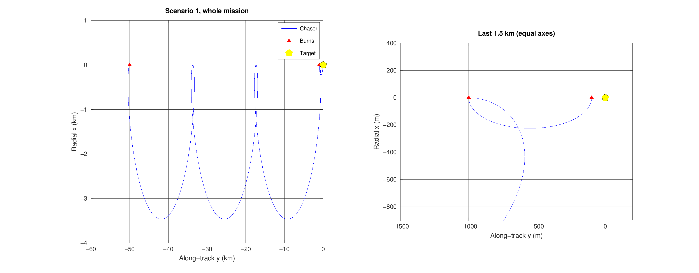

# Rendezvous and Docking Guidance in LEO

MATLAB simulation of a 1000 kg chaser spacecraft that has to meet a target in
a 400 km orbit and dock with it. Far from the target I used the
Hill-Clohessy-Wiltshire (HCW) equations and impulsive maneuvers (phasing,
Hohmann transfer, radial hop). In the last 100 m a PD controller follows a
glide slope to the docking port.

Full report: [report/report.pdf](report/report.pdf)

## Scenarios and results

| | Scenario 1 | Scenario 2 | Scenario 3 |
|---|---|---|---|
| Start | 50 km behind, same orbit | 100 km behind, 2.5 km lower | 100 m, on V-bar |
| Maneuvers | 5 impulses | 6 impulses | PD control |
| Delta-V | 2.770 m/s | 2.789 m/s | 0.325 m/s |
| Propellant | 1.283 kg | 1.292 kg | 0.151 kg |
| Time | 5.73 h | 7.97 h | 9.2 min |

Full mission (Scenario 2 + Scenario 3): 3.114 m/s, 8.12 h, 1.442 kg of
propellant. Contact speed is 0.100 m/s.



Other things I checked:

- With normal Cartesian coordinates the HCW error after three orbits from
  50 km is 21 km. With curvilinear coordinates it is 25 m.
- Phasing cost and time are connected: delta-V x time = 2/3 x distance.
- A much faster controller (Kp = 0.1, Kd = 0.5) needs 184 N instead of 5.7 N
  and does not improve the contact accuracy.
- With 0.4 N thrusters the chaser leaves the approach cone and the safety
  monitor aborts the approach.

## How to run

Open the `matlab` folder in MATLAB and type

```
run_all
```

It takes about 15 s. Figures are saved to `results/`, numbers are printed in
the Command Window.

## Files

| File | Description |
|---|---|
| `params.m` | orbit and vehicle data |
| `hcw_stm.m`, `hcw_propagate.m` | HCW state transition matrix and coasting |
| `two_impulse.m` | two-impulse targeting |
| `curv_to_cart.m` | curvilinear to Cartesian coordinates |
| `nonlinear_relative.m` | two-body model used to check HCW |
| `simulate_burns.m` | burn plan with HCW coasts |
| `docking_sim.m` | glide slope, PD controller, noise, safety monitor |
| `scenario1.m` ... `scenario3.m` | the three scenarios |
| `plot_*.m`, `save_fig.m` | figures |

## Limitations

- Circular target orbit, no J2 or drag.
- Impulsive burns at long range.
- The chaser is a point mass with perfect attitude.
